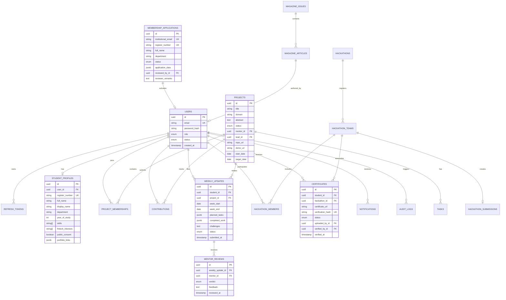

# 🏗️ Backend System Architecture: Fintech Innovation Team Portal

## 1. Executive Summary & Architectural Vision

The **Fintech Innovation Team Portal** is an enterprise-grade academic-fintech innovation management platform designed to centralize student onboarding, project tracking, weekly mentorship workflows, hackathon lifecycle management, certificate verification, institutional reporting, and digital magazine publishing.

### Key Architectural Characteristics
- **Architecture Pattern**: Clean Modular Monolith (Domain-Driven Design / Hexagonal Architecture). This provides clear module boundaries, loose coupling, and transactional consistency required for complex state machines, while allowing future extraction into microservices if scaling necessitates.
- **Language & Runtime**: Node.js (v20+ LTS) with strict TypeScript 5.x.
- **Framework & Core**: NestJS or Express/Fastify with Dependency Injection, Zod for schema validation, and Prisma/Drizzle ORM.
- **Primary Database**: PostgreSQL 16+ with ACID guarantees, JSONB for flexible evidence metadata, and Row-Level Security (RLS) support.
- **Caching & Job Queue**: Redis 7.x with BullMQ for asynchronous workloads (PDF generation, bulk report export, email notifications, virus scanning).
- **Object Storage**: S3-compatible Object Storage (MinIO on-premise or AWS S3 / Cloudflare R2) with strict private buckets and pre-signed time-limited access URLs.

---

## 2. High-Level Backend Architecture Diagram

```mermaid
graph TB
    subgraph Client Layer
        PW[Public Showcase UI - React]
        SP[Student Portal - React]
        AP[Admin/Mentor Dashboard - React]
    end

    subgraph API Gateway & Edge Layer
        CF[Cloudflare / NGINX Reverse Proxy]
        RL[Rate Limiter & WAF]
        SSL[SSL Termination & Security Headers]
    end

    subgraph Application Server - Modular Monolith [Node.js / TypeScript]
        subgraph Inbound Adapters [Transport Layer]
            REST[REST Controllers / OpenAPI 3.0]
            WS[WebSocket / SSE Gateways]
            Cron[Scheduled Task Runners]
        end

        subgraph Cross-Cutting Middleware
            AuthM[JWT Auth & Token Verifier]
            RBAC[RBAC & ABAC Policy Guard]
            ValM[Zod Input Validation Pipe]
            AuditM[Audit Interceptor & Request Context]
            ErrM[RFC 7807 Global Error Handler]
        end

        subgraph Core Domain Modules
            M_Auth[Identity & Access Module]
            M_Member[Membership & Onboarding Module]
            M_Proj[Project & Contribution Module]
            M_Prog[Weekly Progress & Mentorship Module]
            M_Hack[Hackathon & Certificate Module]
            M_Mag[Magazine Editorial Module]
            M_Rep[Institutional Reporting Engine]
            M_Notif[Notification Dispatcher]
            M_Doc[Document & Evidence Storage Manager]
            M_Audit[Audit Log & Compliance Subsystem]
        end

        subgraph Event Bus & Background Workers
            EventBus[In-Memory Domain Event Bus]
            Queue[BullMQ Job Producer]
        end
    end

    subgraph Async Processing Layer [Worker Processes]
        Worker_Report[Report Worker - Puppeteer / ExcelJS]
        Worker_Email[Email Worker - SMTP / SES]
        Worker_Virus[File Scanner Worker - ClamAV]
    end

    subgraph Data & Storage Layer
        PG[(PostgreSQL 16 Primary + Read Replica)]
        Redis[(Redis 7 - Cache & Job Broker)]
        S3[(Private Object Storage - MinIO/S3)]
    end

    Client Layer --> CF
    CF --> RL --> SSL --> REST & WS
    REST & WS --> Cross-Cutting Middleware
    Cross-Cutting Middleware --> Core Domain Modules
    Core Domain Modules --> EventBus & Queue
    EventBus --> Core Domain Modules
    Queue --> Redis
    Redis --> Worker_Report & Worker_Email & Worker_Virus
    Core Domain Modules --> PG
    Core Domain Modules --> Redis
    Worker_Report & Worker_Virus --> S3
    M_Doc --> S3
```

---

## 3. Layered Component Architecture (Hexagonal / Clean Architecture)

Each domain module is organized into 4 strict layers:

```
src/modules/<module_name>/
├── controllers/          # Inbound Adapters: HTTP requests, route definitions, serialization
├── dtos/                 # Request/Response data transfer objects with Zod schemas
├── services/             # Application Services: Orchestration, transaction management, use cases
├── domain/               # Domain Layer: Core business rules, state machines, entity logic
│   ├── entities/
│   ├── state-machines/
│   └── events/
├── repositories/         # Outbound Ports & Adapters: DB access, Prisma queries, caching
└── interfaces/           # Type contracts and injection tokens
```

### Layer Rules
1. **Domain Layer**: Zero external dependencies. Enforces state transitions (e.g., Weekly Update lifecycle, Application status transitions).
2. **Application Layer**: Coordinates domain entities, manages DB transactions (`Prisma.$transaction`), dispatches events (`DomainEventEmitter`), and interacts with background workers.
3. **Infrastructure / Persistence Layer**: Implements repository interfaces, manages caching strategies, executes database migrations and query optimizations.
4. **Transport Layer**: Translates HTTP/WebSocket payloads, triggers Zod validation pipes, and returns standardized responses.

---

## 4. Subsystem Breakdown & Technical Specifications

### 4.1. Identity, Authentication & Access Control (RBAC + ABAC)
- **Token Strategy**: 
  - Access Token: Short-lived asymmetric JWT (15-minute expiration) signed via RS256/EdDSA.
  - Refresh Token: Long-lived opaque token (7 days) stored as cryptographically hashed SHA-256 in PostgreSQL and Redis with family-based reuse detection (automatic token revocation upon breach).
  - Cookie Policy: `HttpOnly`, `Secure`, `SameSite=Strict`.
- **Hybrid RBAC + ABAC Model**:
  - **RBAC**: Roles (`Super Admin`, `Faculty Coordinator / Admin`, `Mentor`, `Team Lead`, `Student`, `Magazine Editor`, `Management Viewer`, `Public Visitor`).
  - **ABAC (Attribute-Based Policies)**:
    - *Policy 1*: A student can only view/edit their own draft weekly updates (`user.id === update.studentId && update.status === 'Draft'`).
    - *Policy 2*: A mentor can only evaluate students/teams explicitly assigned to them (`assignmentRepository.isMentorAssigned(mentorId, studentId)`).
    - *Policy 3*: A Team Lead can submit hackathon documents and certificates on behalf of team members, but **cannot self-verify** (`reviewer.id !== uploader.id && reviewer.role in ['Admin', 'Mentor']`).
    - *Policy 4*: PII (Register numbers, phone numbers, private evidence) is masked on public endpoints and restricted strictly to coordinators/admins.

### 4.2. Student Onboarding & Membership Subsystem
- **Application State Machine**:
  ```
  [Unsubmitted] ──> [Pending] ──┬──> [Clarification Required] ──> [Pending (Resubmitted)]
                                ├──> [Approved] ──> [Account Activated] ──> [Active Student]
                                └──> [Rejected]
  [Active Student] ──> [Suspended / Inactive]
  ```
- **Invariants**:
  - Institutional email validation regex (`@college.edu` or configured institutional domain).
  - Deduplication lock on `registerNumber` and `institutionalEmail` to prevent multiple concurrent pending applications.
  - Mandatory consent flag (`publicProfileConsent: boolean`) recorded with timestamp.

### 4.3. Project & Contribution Tracking Subsystem
- **Entities**: `Project`, `ProjectMembership`, `Milestone`, `Task`, `Contribution`, `ContributionEvidence`.
- **Contribution Areas**: `Design`, `Coding`, `Testing`, `Research`, `Documentation`, `Presentation`, `Coordination`.
- **Business Rule**: Student contribution description and reviewer feedback are stored in separate immutable audit records. A mentor's review never overwrites student-submitted evidence or narrative.

### 4.4. Weekly Plan & Progress Tracking Subsystem
- **Weekly Progress State Machine**:
  ```
  [Draft] ──> [Submitted] ──> [Under Review] ──┬──> [Revision Required] ──> [Draft/Resubmitted]
                                               └──> [Verified]
  ```
- **Time Window Rules**: Weekly submission windows open on Friday 00:00 and lock on Sunday 23:59. Submissions outside this window are flagged as `Late Submission` for coordinator reporting.
- **Carryover Logic**: Unfinished planned tasks automatically roll over as candidate tasks for the subsequent week's draft.

### 4.5. Hackathon Management & Certificate Verification Subsystem
- **Lifecycle**: `Registration` ➔ `Team Formation` ➔ `Submission` ➔ `Outcome Tracking` ➔ `Certificate Verification`.
- **Non-Self-Verification Engine**:
  - Anti-tampering check: When a Team Lead uploads certificates for team members, the system records `uploadedByUserId`.
  - The verification service verifies that `verify(certificateId, verifierUserId)` satisfies `verifierUserId !== certificate.uploadedByUserId` AND `verifier.role in ['Admin', 'FacultyCoordinator']`.
- **Unique Verification Code**: Each verified certificate receives an immutable UUIDv4 / nanoid verification hash with a public QR code verification endpoint (`/api/v1/verify-certificate/:hash`).

### 4.6. Institutional Reporting & Analytics Engine
- **Engine Design**: Dedicated asynchronous worker pool (BullMQ) to avoid blocking the event loop on heavy data aggregation and PDF rendering.
- **Pipeline**:
  1. REST Controller accepts filter query params (Academic Year, Semester, Department, Status, Date Range).
  2. For instantaneous queries (< 100 rows): Streamed as JSON or CSV directly.
  3. For complex institutional reports (PDF / Multi-sheet Excel with historical trends):
     - API returns `202 Accepted` with a `jobId`.
     - Worker retrieves pre-aggregated relational data via optimized indexing.
     - PDF: Headless Chrome / Puppeteer via custom HTML/Tailwind report templates.
     - Excel: `exceljs` streaming writer with styling and formulas.
     - Result is stored in S3/MinIO with a 24-hour signed download URL and in-app notification delivered to the requester.

### 4.7. Digital Magazine Editorial Subsystem ("Fintech Innovation Monthly")
- **Workflow**: `Article Draft` ➔ `Submitted to Editor` ➔ `Editor Review / Revision` ➔ `Faculty Coordinator Approval` ➔ `Scheduled / Published`.
- **Publication Bundle**: Bundles approved markdown/rich-text articles into a release issue, generates a unified print-ready PDF, and publishes a public static web edition.

### 4.8. Document Security & Storage Subsystem
- **Direct S3 Upload via Pre-signed URLs**:
  1. Client requests upload ticket (`POST /api/v1/documents/upload-intent`) with `filename`, `mimeType`, and `fileSizeBytes`.
  2. Server validates MIME against whitelist (`application/pdf`, `image/png`, `image/jpeg`), enforces max sizes (10MB for PDFs, 5MB for images), and issues a pre-signed S3 `PUT` URL valid for 5 minutes.
  3. Client uploads directly to S3 Quarantine bucket.
  4. S3 ObjectCreated event / Webhook triggers background virus scanner (ClamAV container).
  5. If clean: Object moved to production private bucket and marked `ACTIVE`.
  6. If infected: Object immediately deleted and alert logged.
- **Restricted Access**: All file downloads occur through temporary signed `GET` URLs (15-minute expiration) generated only after authorization verification.

### 4.9. Audit Logging & Compliance Subsystem
- **Audit Interceptor**: Intercepts all state changes (`POST`, `PUT`, `PATCH`, `DELETE`).
- **Audit Record Schema**:
  - `id`: UUIDv4
  - `actorId`: User ID (or system)
  - `actorRole`: Snapshot of active role
  - `action`: e.g., `APPLICATION_APPROVED`, `WEEKLY_UPDATE_VERIFIED`, `CERTIFICATE_VERIFIED`
  - `targetEntity`: Entity name (e.g., `WeeklyUpdate`)
  - `targetId`: Entity UUID
  - `ipAddress`: Client IP (anonymized/hashed if required by privacy policy)
  - `userAgent`: Client user agent string
  - `changes`: JSONB patch diff `{ before: {...}, after: {...} }`
  - `timestamp`: UTC ISO timestamp (immutable, database-enforced `now()`)

---

## 5. PostgreSQL Database Schema & Relational Model



---

## 6. API Route Specification (RESTful + Versioning)

Base URI: `/api/v1`

### Authentication & Profiles
- `POST /auth/login` - Authenticate with email/password, issues JWT & Refresh Token cookie.
- `POST /auth/refresh` - Rotate refresh token & issue new JWT.
- `POST /auth/logout` - Revoke refresh token in Redis.
- `GET  /users/me` - Current user profile, role permissions, and active alerts.
- `PUT  /users/me/profile` - Update allowed profile fields (bio, links, public consent).

### Onboarding & Membership
- `POST /applications` - Public application submission (Rate-limited, captcha-protected).
- `GET  /applications` - Admin: List pending applications with pagination & filters.
- `GET  /applications/:id` - Admin: Detailed application review.
- `PATCH /applications/:id/status` - Admin: Approve, Reject, or Request Clarification.

### Projects & Contributions
- `GET  /projects` - List projects (Public: approved/featured; Authenticated: all scoped).
- `POST /projects` - Admin/Lead: Propose new project.
- `GET  /projects/:id` - Detailed project roadmap, milestones, and active team.
- `POST /projects/:id/contributions` - Student: Record individual contribution with evidence.
- `PATCH /contributions/:id/review` - Mentor: Review & approve/comment on contribution.

### Weekly Progress & Mentorship
- `GET  /weekly-updates/current` - Student: Get current week's active draft or template.
- `POST /weekly-updates` - Student: Save draft or submit weekly update.
- `GET  /weekly-updates/mentor-queue` - Mentor: Queue of pending updates for assigned mentees.
- `POST /weekly-updates/:id/reviews` - Mentor: Submit review (Verified / Revision Required).

### Hackathons & Certificates
- `POST /hackathons` - Coordinator: Create new hackathon event.
- `POST /hackathons/:id/teams` - Team Lead: Register team & assign members.
- `POST /hackathons/:id/certificates` - Team Lead: Upload certificates for members.
- `PATCH /certificates/:id/verify` - Admin/Mentor: Verify certificate authenticity.
- `GET  /public/verify-certificate/:hash` - Public: Verify certificate legitimacy.

### Reports Engine
- `POST /reports/export` - Coordinator: Enqueue institutional report (PDF/Excel) with filters.
- `GET  /reports/jobs/:jobId` - Check status of async report generation.
- `GET  /reports/download/:fileToken` - Download generated report.

---

## 7. Security Architecture & Threat Modeling

| Threat Vector | Mitigation Strategy |
|---|---|
| **Broken Object Level Auth (BOLA / IDOR)** | Enforce strict policy-based guards (`CanAccessProjectGuard`, `IsOwnerOrAdminGuard`) verifying entity ownership at the database level on every request. |
| **Tampering with Certificates** | Non-self-verification policy enforced via code assertion; cryptographic verification hash issued upon verification; evidence stored on immutable object storage. |
| **Malicious File Uploads** | MIME magic-byte sniffing (reject pure extension spoofing); direct-to-quarantine S3 pre-signed upload; asynchronous ClamAV virus scanning; private read-only S3 buckets. |
| **Brute Force & Credential Stuffing** | Redis-backed sliding window rate limiting (5 attempts/min on `/auth/login`); bcrypt/argon2id password hashing; account lockout after 5 consecutive failures. |
| **PII Leakage** | Separate database views/DTO serializers for public vs. authenticated views; Student Register Numbers and personal phones are strictly stripped out of public queries via Zod output sanitization. |
| **Data Loss & Disaster Recovery** | Daily PostgreSQL WAL archiving to multi-region cold storage; continuous database replication with automated failover; point-in-time recovery (PITR) up to 30 days. |
